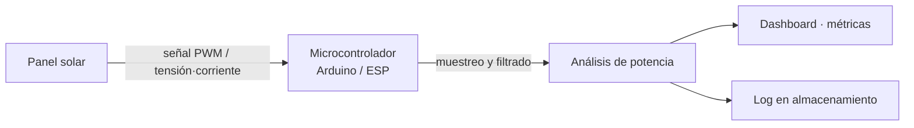

# mppt-solar-monitor

Monitoreo de paneles solares mediante el análisis de señales **PWM/MPPT**. Repositorio en **etapa de planificación**; aún no hay código fuente commiteado.

## Contenido

- [Objetivo](#objetivo)
- [Arquitectura](#arquitectura)
- [State](#state)
- [CI](#ci)
- [Roadmap](#roadmap)
- [Licencia](#licencia)

## Objetivo

Medir y visualizar la **potencia de salida** de paneles solares a partir de la señal PWM que emite un controlador de carga solar (MPPT) o mediante sensores de tensión/corriente.

## Arquitectura

Diagrama **objetivo** (aún sin implementar):

## Estado

- Proyecto en **planificación**: no hay directorios de código ni archivos fuente todavía.
- El repositorio contiene únicamente CI, licencia y README.

## CI

`GitHub Actions` ejecuta un lint de YAML (`yamllint`) sobre el repositorio en cada push y PR.

## Roadmap

- [ ] Definir el hardware objetivo (plataforma del microcontrolador)
- [ ] Definir el formato de entrada de la señal PWM (frecuencia, duty-cycle)
- [ ] Captura y filtrado de la señal
- [ ] Cálculo de potencia y métricas
- [ ] Dashboard web de visualización

## Licencia

MIT